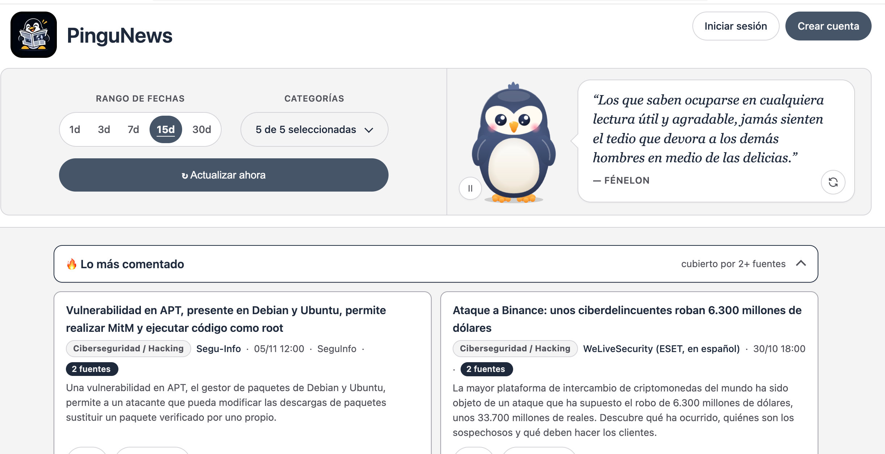
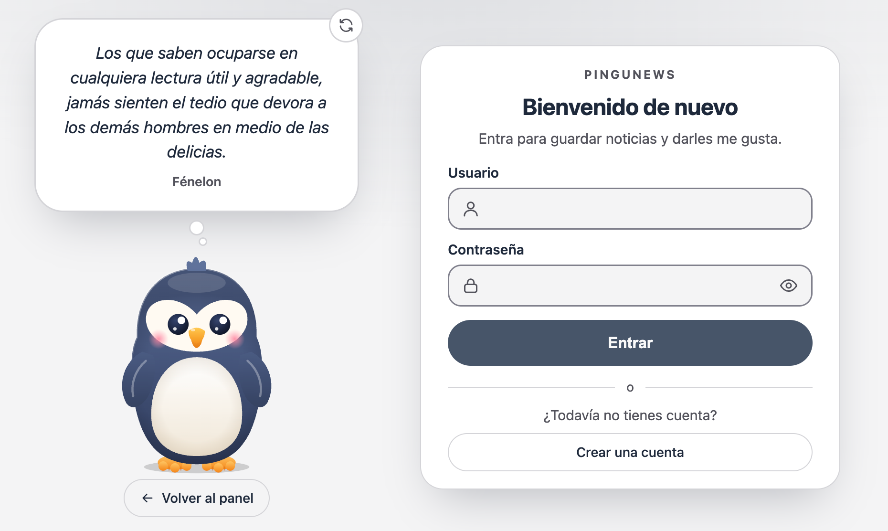
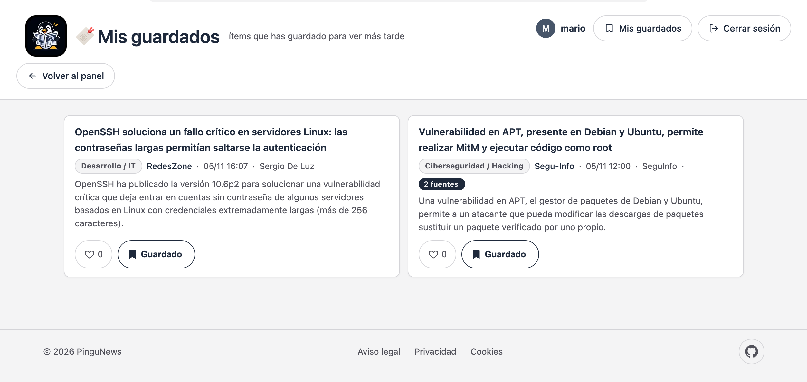

# Herramienta de monitorización — Ciberseguridad, Hacking, Empleo e IT (ES)

Recopila automáticamente contenido reciente en español de ciberseguridad,
hacking, empleo del sector y noticias de IT/desarrollo, y lo muestra en un
panel web (FastAPI) con lo de los últimos días, sin tener que buscarlo a mano.

## Capturas

### Panel principal


Vista pública del panel (sin iniciar sesión). De arriba abajo:

- **Cabecera**: logo y nombre de la app a la izquierda; a la derecha los botones **Iniciar sesión** y **Crear cuenta**.
- **Rango de fechas** (`1d · 3d · 7d · 15d · 30d`): cuánto hacia atrás se muestran noticias. En la captura está activo **15d**, el valor por defecto.
- **Categorías**: desplegable con las categorías activas (aquí "5 de 5 seleccionadas"): Ciberseguridad, Tendencias del sector, Empleo, Desarrollo/IT y Actualidad.
- **↻ Actualizar ahora**: lanza una recolección de las fuentes RSS sin usar la terminal.
- **Mascota y frase del día**: el pingüino, que reacciona al clic, y una frase motivadora (en la captura, de Fénelon) con botón para pedir otra y botón de pausa de las animaciones.
- **🔥 Lo más comentado**: noticias cubiertas por **2 o más fuentes** a la vez (insignia "2 fuentes"), una señal gratuita de relevancia. Cada tarjeta muestra título, categoría, fuente, fecha y resumen.

### Inicio de sesión


Pantalla **"Bienvenido de nuevo"**: formulario con usuario y contraseña (con botón para mostrarla/ocultarla), botón **Entrar** y acceso a **Crear una cuenta**. A la izquierda, la mascota con una frase en un bocadillo de pensamiento y el botón **Volver al panel**. Tener cuenta permite dar "me gusta" y guardar noticias para después; navegar y buscar no requiere cuenta.

### Mis guardados


Vista de un usuario con la sesión iniciada (aquí `mario`). En la cabecera aparecen su avatar y nombre, el acceso **Mis guardados** y **Cerrar sesión**. La página lista las noticias guardadas con el botón **Guardado** activo y el contador de "me gusta" (♡), y enlaza con **Volver al panel**. Es privada: cada usuario solo ve las suyas. Al pie, el footer con **Aviso legal**, **Privacidad**, **Cookies** y el enlace a GitHub.

## Buscador de noticias

Encima de los filtros hay un cuadro **"Buscar noticias"** para filtrar el panel por palabras:

- Busca en **título, resumen, fuente y autor**.
- **No distingue mayúsculas ni acentos**: `vulnerabilidad`, `VULNERABILIDAD` y `vulnerabilidád` dan lo mismo.
- Con varias palabras (`debian apt`) deben aparecer **todas** en la misma noticia.
- Se combina con el rango de días y las categorías, y **se conserva** al cambiar de rango, de categoría, de página o al pulsar "Actualizar ahora". El botón **Limpiar** quita la búsqueda.
- El título de la sección pasa a "Resultados para «…»" y el contador muestra cuántas coinciden; si no hay ninguna, se indica con un mensaje.
- Es un parámetro de URL (`/?q=debian&dias=30`), así que una búsqueda se puede guardar o compartir como enlace. Se filtra en el servidor, el texto se escapa en la plantilla (sin XSS) y se limita a 100 caracteres y 8 palabras.

## Instalación

```bash
python3 -m venv venv
source venv/bin/activate
pip install -r requirements.txt
```

Requiere Python 3.11+.

## Configuración

Todo se configura en [`config/config.yaml`](config/config.yaml):

- `general.lookback_hours`: cuánto hacia atrás (en horas) intenta traer cada fuente **en cada recolección** (por defecto 360h = 15 días, para no dejar huecos; el histórico ya deduplica así que un valor amplio es seguro).
- `dashboard.dias_por_defecto` / `dashboard.opciones_dias`: qué rango de días se ve por defecto en el panel web y qué botones de rango se muestran (por defecto 15, con botones 1/3/7/15/30 días).
- `empleo.filtro_relevancia`: palabras (por palabra completa) que debe contener el **puesto** para que una oferta de RemoteOK o de un feed RSS de empleo se considere relevante.
- `keywords.tendencias_sector`: palabras clave de la categoría "📺 Tendencias del sector" (despidos, desempleo, crecimiento, inversión, fusiones...) — pensada para tener material que comentar en directo.
- `keywords`: palabras clave por categoría, usadas para clasificar y para filtrar.
- `rss_feeds`: lista de feeds RSS de noticias. **Añadir uno nuevo no requiere tocar código**, basta con añadir una entrada:
  ```yaml
  - nombre: "Mi fuente"
    url: "https://ejemplo.com/feed/"
    categoria: ciberseguridad   # o desarrollo_it / empleo / actualidad
  ```
- `twitter`: desactivado por defecto. Activar con `enabled: true`.
- `empleo`: fuentes de ofertas de trabajo.
- `notificaciones.enabled: false`: no hay notificaciones configuradas (el usuario no dispone de credenciales SMTP ni bot de Telegram). El único canal es el panel web.

## Ejecución

```bash
./venv/bin/uvicorn app:app --reload --port 8000
```

Abre **http://127.0.0.1:8000** en el navegador. Desde ahí puedes:
- Elegir cuántos días hacia atrás ver (botones 1/3/7/15/30 días; por defecto 15).
- **Buscar por palabras** en el cuadro "Buscar noticias" (ver sección más arriba).
- Filtrar por categoría (Ciberseguridad, 📺 Tendencias del sector, Empleo, Desarrollo/IT, Actualidad) con las casillas.
- Pulsar **"↻ Actualizar ahora"** para lanzar una recolección nueva sin usar la terminal (tarda unos segundos; la página se recarga sola con lo nuevo).
- Crear una cuenta / iniciar sesión (arriba a la derecha) para **dar "me gusta"** a las noticias y **guardarlas para ver más tarde** (sección "🔖 Mis guardados"). Sin iniciar sesión puedes ver todo igualmente, solo que esos botones te mandan a iniciar sesión.

## Estructura del proyecto

```
app.py         # panel web FastAPI: lee de SQLite, filtros, auth, likes/guardados
auth.py        # hash de contraseñas (PBKDF2-HMAC-SHA256, sin dependencias externas)
main.py        # CLI de recolección, para ejecutar a mano o por cron
collector.py   # lógica de recolección compartida entre app.py y main.py
dedup.py       # deduplicado por similitud de título + conteo de cobertura
rss.py         # fuente: feeds RSS/Atom
twitter.py     # fuente: Twitter/X (snscrape, desactivado por defecto)
empleo.py      # fuente: ofertas de empleo (RemoteOK + Jobicy + RSS configurables)
classifier.py  # clasificación por palabras clave + resumen heurístico
db.py          # histórico, deduplicado, usuarios, likes, guardados en SQLite
utils.py       # utilidades comunes (normalización, logging, modelo Item)
config/config.yaml  # configuración central editable
templates/dashboard.html.j2   # panel principal
templates/login.html.j2       # inicio de sesión
templates/registro.html.j2    # creación de cuenta
templates/guardados.html.j2   # ítems guardados por el usuario
templates/_estilos.html.j2    # CSS compartido por todas las páginas
templates/_macros.html.j2     # tarjeta de ítem y área de usuario, reutilizadas
templates/_favicon.html.j2    # <link> del favicon/apple-touch-icon, compartido
static/logo.png               # logo de la app (header, login, registro)
static/favicon.png            # favicon (64x64, generado a partir del logo)
static/apple-touch-icon.png   # icono para "añadir a inicio" en iOS (180x180)
```
